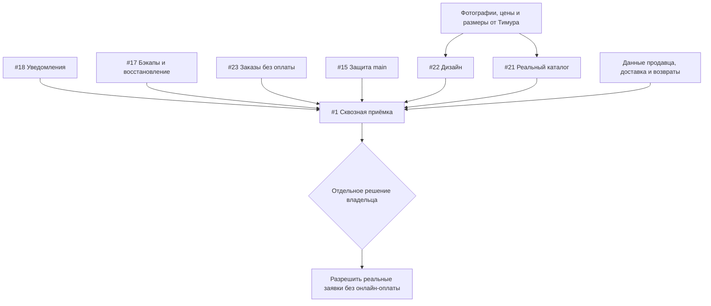

# Roadmap — Atelier Telegram Shop v1

**Актуальность:** 1 ноября 2026 · **Координация и статусы:** [GitHub issue #24](https://github.com/Ai-b0ss/atelier-telegram-shop/issues/24) · **Техническая матрица испытаний:** [15 сценариев](docs/telegram-fashion-launch-research-2026-11-01.md)

> **Цель v1:** мини-ателье внутри Telegram, где можно посмотреть настоящие вещи, выбрать размер/цвет, отправить заказ без онлайн-оплаты, подать заявку на индивидуальный пошив и получить подтверждение менеджера. Продукт должен быть удобным, визуально цельным, бесплатным в эксплуатации в рамках выбранных квот и устойчивым к типовым сбоям.

## 1. Текущее состояние и границы

| Область | Подтверждённый статус | Следующая проверка |
|---|---|---|
| Telegram-бот и хостинг | Демо на Cloudflare Workers + D1, Telegram webhook; Windows polling отключён | Независимая приёмка с двумя реальными Telegram-аккаунтами |
| Витрина Mini App | Каталог, корзина, заявки, админка, дизайн Editorial Atelier v2 | Визуальный редизайн под реальные фото, настоящие iOS/Android WebView |
| Данные товаров | 3 **вымышленных** изделия / 4 варианта, нет фото | Получить материалы от Тимура, безопасно импортировать |
| Заказы и склад | Атомарное списание в D1, защита от дублей, триггеры отмены | Реальные многопользовательские и fault-injection сценарии |
| Уведомления | Сообщение может потеряться после успешного коммита, если Bot API отказал | D1 transactional outbox, retry и мониторинг |
| Резервные копии | Локальный DPAPI CurrentUser экспорт + усиленная проверка SQL (PR #19) | Переносимое шифрование, независимое хранение, восстановление в тестовую D1 |
| Защита GitHub | Активен `main` ruleset, CI обязательны, PR #19/#20 слиты | Негативный тест запрета плохого merge и прямого push |
| Платежи | **Не подключены и не нужны для v1** | Не добавлять эквайринг, Stars или криптокассу |

**Стоп-факторы:** `DEMO_MODE=1` и `STORE_READY=0` не трогать в обычных PR. Открытие реальных заказов — отдельное решение владельца только после приёмки и бизнес-данных. Не размещать реальные данные покупателей, токены, фото без прав или резервные копии в GitHub.

## 2. Рабочий граф задач

| Пакет | Приоритет | GitHub | Зависимости | Definition of Done |
|---|---|---|---|---|
| Надёжная доставка уведомлений (D1 outbox и Cron) | P0 | [#18](https://github.com/Ai-b0ss/atelier-telegram-shop/issues/18) | Нет внешних; изолированная D1 | При искусственном отказе Bot API ни одно событие не теряется, повтор заказа не создаётся |
| Переносимые бэкапы и восстановление | P0 | [#17](https://github.com/Ai-b0ss/atelier-telegram-shop/issues/17) | Безопасное хранилище + отдельная D1 | Зашифрованный экспорт восстанавливается вне текущего Windows-профиля; проверены связи/триггеры |
| Заказ без интегрированных платежей | P0 | [#23](https://github.com/Ai-b0ss/atelier-telegram-shop/issues/23) | #18 для гарантированных уведомлений | Два клиента не создают дубли; понятный заказ, контакт и доставка, ручное согласование |
| Запрет обхода CI и PR в main | P0 | [#15](https://github.com/Ai-b0ss/atelier-telegram-shop/issues/15) | Активный ruleset уже есть | Зафиксирован отрицательный безопасный тест; обход не допускается |
| Профессиональный дизайн и mobile UX | P1 | [#22](https://github.com/Ai-b0ss/atelier-telegram-shop/issues/22) | Можно начинать на синтетических товарах; финал после фото | Согласованный дизайн, все состояния/размеры, тесты iOS/Android |
| Импорт ассортимента от Тимура | P1 | [#21](https://github.com/Ai-b0ss/atelier-telegram-shop/issues/21) | Фото/описания/цены/размеры/остатки от владельца | Валидатор и dry-run; реальный каталог подтверждён, без фиктивных товаров |
| Многопользовательская мобильная приёмка и запуск | P1 — релизный гейт | [#1](https://github.com/Ai-b0ss/atelier-telegram-shop/issues/1) | Все P0, реальные товары, условия продавца и доставки | Полные сценарии и аварийные тесты + отдельное разрешение на открытие заявок |

### Зависимости

## 3. Быстрые циклы для ИИ-агентов

**Единица планирования — небольшой проверяемый результат, а не трудодень человека.** Целевой размер: один узкий дефект, миграция с тестами, одна группа UI-состояний или один интеграционный сценарий на **один автономный цикл порядка 15–30 минут**, когда нет внешних блокеров. Это организационный ориентир, не гарантированная длительность и тем более не оценка всей задачи.

**Параллельные дорожки без пересечения файлов:**

1. **Reliability:** #18 → тесты отключения Telegram и повторов. Отдельная ветка, D1 миграции только с проверкой `schema.sql` и реальных миграций, без изменения рабочей базы.
2. **Recovery:** #17 → переносимый архив, локальное восстановление, изолированная Cloudflare D1. Никаких операций `time-travel restore` на опубликованной базе.
3. **Commerce UX:** #23 → текст и стейт-машина без платежей, проверка восстановления/идемпотентности, согласование с #18.
4. **Design:** #22 → 2–3 композиции на одной синтетической коллекции, адаптивность, accessibility, затем настоящие товары. Визуальные изменения не должны требовать переписывать API и D1.
5. **Merchandising:** #21 → шаблон ассортимента, валидатор и dry-run до получения фото. С реальными данными — отдельная проверенная загрузка после согласования.
6. **QA/security:** #15 и #1 → контрактные тесты, негативные сценарии, независимый пользователь и настоящий мобильный Telegram.

**Контракт каждого ИИ-пакета:** `issue → описание цели/DoD → отдельная ветка → реализация → автоматические и отрицательные тесты → ревью диффа → PR → зелёные обязательные проверки → merge → при необходимости отдельный безопасный deploy → подтверждение факта → обновление issue`.

- Не делать много несвязанных изменений в одном PR.
- Не считать зелёный CI доказательством реальной мобильной работоспособности.
- Проверять конфликт с текущими ветками/PR перед изменением общего файла.
- Критичные ошибки исправлять до merge, а не просить пользователя первым тестировать продукт.
- Если агент не может проверить реальный прибор/аккаунт, честно записывать проверку как `BLOCKED` и её необходимое доказательство.
- Никакой фоновой работы «после ответа» без явной задачи/автоматизации.

## 4. Поступление настоящих товаров

Подготовить безопасный шаблон импорта заранее. Для каждой вещи указать:

| Обязательно | Желательно |
|---|---|
| Название, фото с правом использования, цена, категория, доступность, вариант размера/цвета, количество или «под заказ», артикул | Материалы, уход, размерная сетка, фото спереди/сзади/детали, срок пошива, параметры доставки, себестоимость только для админа |

Загрузка проходит `приём данных → проверка/dry-run → приватный staging → визуальное ревью → согласование → публикация`. Не генерировать несуществующее наличие, цены или фото. Пока материалы не пришли, #21 выполняется до staging-инструментов; #22 тестируется на синтетической коллекции.

## 5. Релизные контрольные точки

**M0: инженерная база** — облако работает, CI защищён, продукт остаётся в demo. [PR #19](https://github.com/Ai-b0ss/atelier-telegram-shop/pull/19) и [PR #20](https://github.com/Ai-b0ss/atelier-telegram-shop/pull/20) выполнены; открытые проверки #15/#17/#18 нельзя записывать как выполненные.

**M1: безопасные заявки** — завершены #18, #17, #23; 15 сценариев [A01–A15](docs/telegram-fashion-launch-research-2026-11-01.md) протестированы в синтетической среде, нет потери заказа/остатка. Оплата всё ещё отсутствует.

**M2: готовая витрина** — закончен #22, данные #21 готовы, дизайнерские и технические проверки на реальных фотографиях пройдены. Нет фиктивных цен/товаров в покупательском режиме.

**M3: приемка и разрешение** — проверены iOS + Android Telegram WebView, реальный отдельный покупатель + менеджер, отсутствие утечек, отказоустойчивость и восстановление. Владелец подтверждает данные продавца, сроки/стоимость доставки, политику возврата и обработки персональных данных. Только после этого отдельный контролируемый релиз активирует реальные заявки (без встроенного платежа).

**P2 после M3:** поиск, избранное, автоматические акции, импорт из Telegram-канала, сложная аналитика. Криптовалютные платежи и любые сторонние платёжные сервисы вне согласованного scope v1.

## 6. Статус и корректировка плана

- **Источник истины о состоянии:** связанные GitHub Issues, PR, CI и задокументированные приёмочные результаты, а не устаревшие обещания в чате.
- После каждого PR обновлять соответствующий Issue: что исправлено, чем проверено, что ещё блокирует.
- По мере появления фото и бизнес-условий пересматривать критический путь, **не** переписывая историю уже выполненных задач.
- Реальная дата запуска определяется закрытием M1–M3 и доступностью материалов; до этого не обещать календарный срок.

**Ссылки:** [бизнес-процессы](docs/business-process.md) · [подготовка к продаже](docs/production-readiness.md) · [дизайн-бриф](docs/design-redesign-brief.md) · [исследование аналогов](docs/telegram-fashion-launch-research-2026-11-01.md) · [roadmap issue #24](https://github.com/Ai-b0ss/atelier-telegram-shop/issues/24).
