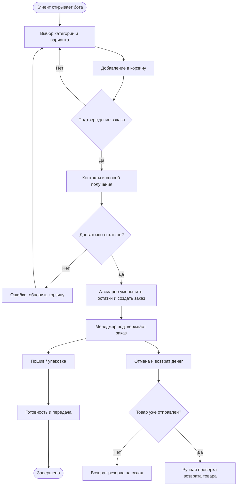
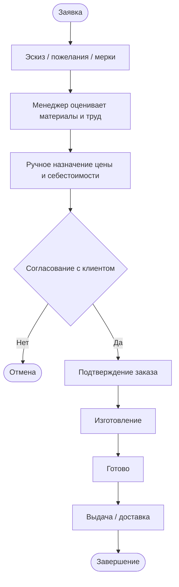

# Модель процесса продаж и индивидуального пошива

## Каталожная продажа (упрощённая BPMN-логика)

## Индивидуальный пошив

**Важные границы реализации:** менеджер вручную задаёт цену и сроки; клиент подтверждает или отклоняет предложенную цену через Telegram. Учёт оплаты остаётся ручным. Бот не подтверждает банковский платёж и не выполняет возвраты. Команды администратора только записывают проверенные вручную события. История статусов и платежи сохраняются отдельно.

## Оценка эффективности

Измерять следует на тестовых сценариях и после внедрения на реальных данных:

- Доля заказов, успешно прошедших цикл от корзины до завершения.
- Среднее время от заявки до подтверждения менеджером.
- Сколько времени менеджер тратит на обработку одной заявки до и после внедрения.
- Число ошибок учёта остатков и расчёта сумм при параллельных заказах.
- Фактические поступления и возвраты отдельно от общей стоимости созданных заказов.

Без реального пилота нельзя достоверно утверждать, что время обработки или выручка улучшились.

## Контрольный контур и ответственность

- Клиент инициирует заявку через личный чат и видит её статус.
- Приложение фиксирует снимок цены и себестоимости из каталога при оформлении.
- Менеджер вручную проверяет оплату и фиксирует поступления / возвраты.
- После отгрузки отмена не восстанавливает остаток автоматически: нужен фактический возврат изделия и ручная складская корректировка.
- Администратор может фильтровать заказы и переключать разрешённые статусы кнопками или командами.
- Кнопка индивидуальной сметы подтверждает только согласие с ценой; фактическая оплата не происходит.
- По завершении или отмене всех заказов клиент может запросить удаление персональных сведений командой `/forgetme` (обезличенные суммы операций остаются в отчётности).
