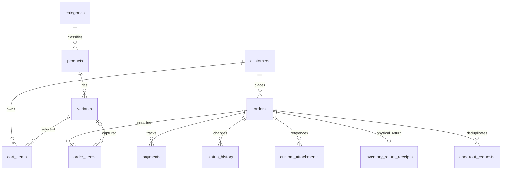

# Модель данных: рабочая облачная версия

Основная СУБД: Cloudflare D1 (SQLite). Исторический локальный
Python/SQLite-бот сохраняется отдельно как резервная реализация.

| Таблица | Что хранит |
|---|---|
| `categories`, `products`, `variants` | Ассортимент, SKU, размеры, цвета, цены, себестоимость, количество; Telegram file_id фото |
| `customers` | Уникальный числовой Telegram ID, имя, username |
| `cart_items` | Выбранные варианты и количества |
| `orders`, `order_items` | Вид заказа, контакты, текущее состояние, суммы, зафиксированная цена позиции и её себестоимость |
| `payments` | Ручной журнал поступлений и возвратов, уникальный номер операции при наличии |
| `status_history` | История переходов для контроля статуса и факта отправки |
| `inventory_return_receipts` | Уникальный на заказ акт физического возвращения уже отправленного изделия; дата, Telegram ID оператора, примечание |
| `custom_attachments` | Telegram file_id фотографий для индивидуального пошива |
| `checkout_requests` | Защита повторной отправки заявки из Mini App |
| `processed_updates`, `sessions` | Защита от повторной обработки Telegram webhook и состояние форм |
| `store_settings` | Реквизиты продавца, правила доставки и возврата, ссылка на политику данных |

## Важные ограничения целостности

- Суммы — целые копейки, без плавающей точки.
- Размер/цвет/цена/себестоимость заказа копируются в `order_items`.
- Оформление нескольких позиций: D1 `batch()` и
  `CHECK(stock >= 0)`; вся запись откатывается при недостатке
  хотя бы одной позиции.
- `AFTER UPDATE orders.status` фиксирует переход в историю.
- `AFTER UPDATE ... status='canceled'` пополняет остаток
  автоматически только **до фактической отправки**.
- `inventory_return_receipts` с `UNIQUE(order_id)` и триггером
  `AFTER INSERT` фиксирует физический возврат и восстанавливает
  ровно одно количество каждого варианта.
- Поступления и возвраты фиксируются вручную, это не журнал реального банка.
- Сохранение контактов ограничено требованиями демонстрации;
  `/forgetme` очищает личные поля закрытых заказов.
- Нельзя автоматически считать отменённый после отправки товар
  находящимся на складе, пока менеджер не принял его физически.

Миграции D1:
`cloudflare/migrations/0001_order_status_triggers.sql`,
`0002_miniapp.sql`, `0003_store_readiness.sql`,
`0004_shipped_return.sql`.

Для безопасности миграцию `0004` накатывают в короткое окно
техобслуживания с приостановленным Telegram webhook,
сохранив ожидающие обновления; перед ней получают D1
Time Travel bookmark. После миграции выполняют тесты,
проверку webhook и контроль остатков.
