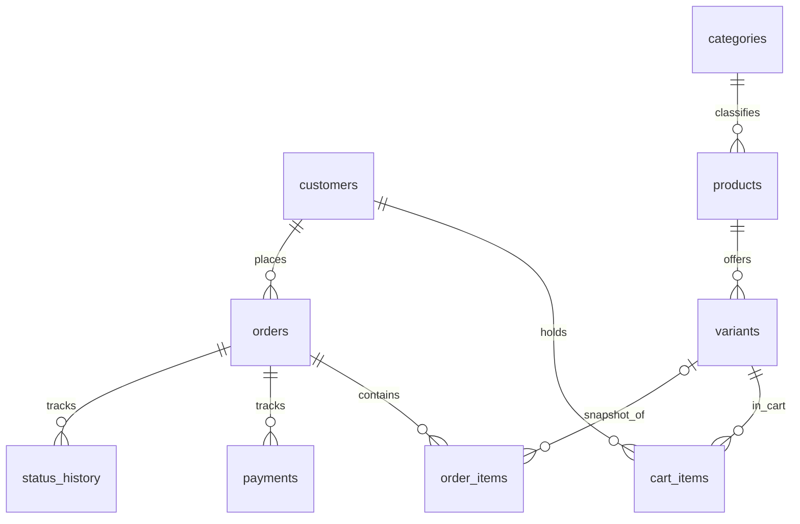

# Структура данных

- `customers`: Telegram ID, имя, контакт. Доступ к заказам по ID клиента.
- `categories / products / variants`: категории, изделия, размер, цвет, SKU, розничная цена, учётная себестоимость и остаток.
- `cart_items`: текущие выбранные варианты и количества.
- `orders`: тип заказа (`catalog` / `custom`), контакты доставки, общая сумма, себестоимость, пожелания, мерки, статус.
- `order_items`: неизменяемый снимок позиции заказа на дату оформления, включая цену и себестоимость.
- `payments`: вручную проверенные поступления и возвраты, без скрытого изменения финансовой истории.
- `status_history`: журнал переходов статуса.

Денежные суммы хранятся в **копейках** (целые числа); это исключает ошибки двоичной арифметики с рублёвыми суммами. Для расчёта учётной себестоимости кастомных изделий менеджер указывает оценку вручную. Для полноценного производства понадобится отдельная модель списания материалов, операций и трудозатрат.

При отмене каталожного заказа остатки восстанавливаются один раз. Если поступили деньги, отмена блокируется до регистрации полного возврата. SQLite проводит оформление с блокировкой записи `BEGIN IMMEDIATE`, исключая продажу одного остатка двум клиентам одновременно.
