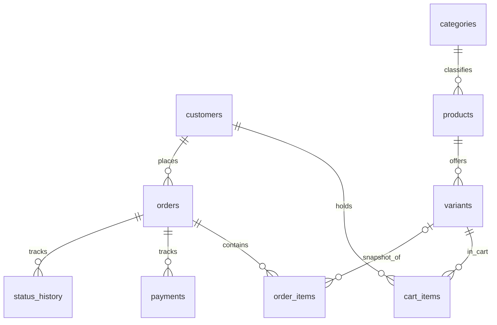

# Структура данных

- `customers`: Telegram ID, имя, контакт. Доступ к заказам по ID клиента.
- `categories / products / variants`: категории, изделия, размер, цвет, SKU, розничная цена, учётная себестоимость и остаток.
- `cart_items`: текущие выбранные варианты и количества.
- `orders`: тип заказа (`catalog` / `custom`), контакты доставки, общая сумма, себестоимость, пожелания, мерки, статус.
- `order_items`: неизменяемый снимок позиции заказа на дату оформления, включая цену и себестоимость.
- `payments`: вручную проверенные поступления и возвраты, без скрытого изменения финансовой истории.
- `status_history`: журнал переходов статуса.

Денежные суммы хранятся в **копейках** (целые числа); это исключает ошибки двоичной арифметики с рублёвыми суммами. Для расчёта учётной себестоимости кастомных изделий менеджер указывает оценку вручную. Для полноценного производства понадобится отдельная модель списания материалов, операций и трудозатрат.

При отмене каталожного заказа до отгрузки остатки восстанавливаются один раз. После отгрузки остаток не увеличивается автоматически, даже при отмене: возврат на склад требует проверки фактического поступления изделия. Если поступили деньги, отмена блокируется до регистрации полного возврата. SQLite проводит оформление с блокировкой записи `BEGIN IMMEDIATE`, исключая продажу одного остатка двум клиентам одновременно.

## Учёт доходов и персональных данных

- Оплаты учитываются по записи каждой операции (поступление или возврат). Отдельно отражается задолженность по заказу: цена минус сумма учтённых поступлений.
- Валовая маржа завершённых заказов = сумма цен завершённых заказов минус их учётная себестоимость. Она не равна остатку денег в кассе и не включает другие расходы.
- При `/forgetme` удаляются контакты, адрес, мерки, пожелания и привязка аккаунта к Telegram ID, если все заказы клиента закрыты. Финансовые суммы и статусы сохраняются обезличенными.
- SQLite подходит для небольшого магазина с одним работающим ботом; перед промышленным масштабированием потребуется отдельная архитектура миграций, резервного копирования и контроля доступа.
