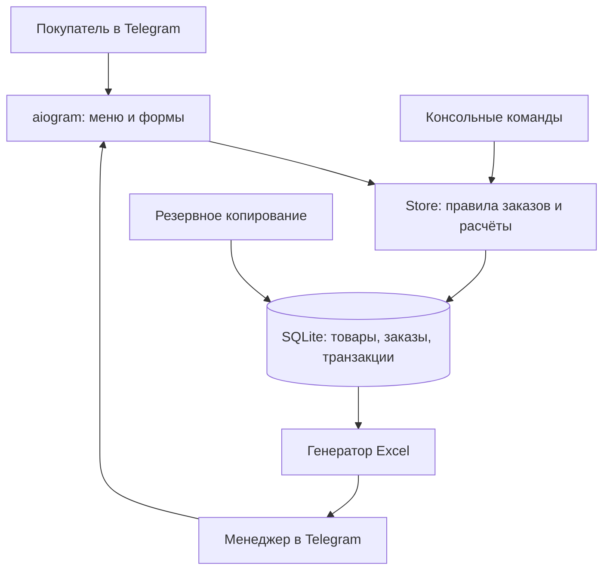

# Инженерный отчёт: автоматизация продажи авторской одежды через Telegram

## 1. Цель и границы проекта

**Цель:** создать доступный небольшой мастерской инструмент, объединяющий продажи готовых изделий, индивидуальный пошив, историю операций, управление заказами и финансовые отчёты.

Система предназначена для одного магазина с одним процессом Telegram long polling, хранит данные локально в SQLite и не проводит реальные банковские операции. «Рабочий MVP» в данном отчёте означает, что локальная логика и интерфейс обработчиков проверены тестами; реальная интеграция Telegram остаётся отдельным приёмочным этапом.

### Матрица покрытия исходных требований

| Требование | Реализация | Проверка | Статус |
|---|---|---|---|
| Смоделировать продажи и индивидуальный заказ | `docs/catalog-sales.bpmn`, `docs/custom-tailoring.bpmn`, пояснение в `business-process.md` | Разбор XML, маршруты потоков и развилки | Готово как модель |
| Проектирование БД | SQLite, 9 таблиц, внешние ключи и проверки, `docs/data-model.md` | 34 теста на ограничения, миграции, остатки, переходы | Готово для MVP |
| Telegram-каталог и корзина | `atelier/bot.py`: категории, варианты, фото по `file_id`, корзина, оформление | Офлайн-контрактные тесты обработчиков, без Telegram API | Требуется живая приёмка |
| Модуль управления заказами | `/orders`, `/order`, `/status`, `/quote`, статусные кнопки | Доменная и офлайн-проверка обработчиков | Готово для MVP |
| Excel и финансовый учёт | `atelier/reports.py`, `/report`, `atelier.export`, `atelier.demo` | Excel-структура и суммы, дубликаты платежей | Готово для MVP |
| Тестирование и оценка эффективности | `tests/`, `docs/test-report.md` | Локальные тесты и воспроизводимая демонстрация | Измерена техническая корректность; бизнес-эффективность требует пилота |

## 2. Архитектура



Бизнес-правила вынесены из Telegram-обработчиков в слой `Store`. Это позволяет тестировать деньги, статусы и складские остатки без интернета или токена бота. Все суммы хранятся как целые копейки; отображение в рублях выполняется только на границе системы.

## 3. Ключевые решения

**Цены и история.** При создании заказа цена/себестоимость копируются в `order_items`, поэтому изменение каталога позже не меняет историю продаж. У индивидуального заказа предложение получает версию `quote_revision`, и клиент подтверждает именно ту смету, которую получил.

**Конкуренция.** Оформление заказа и изменение статусов блокируют другие записи в SQLite (`BEGIN IMMEDIATE`). Два покупателя не могут одновременно заказать последнюю единицу одного товара; повторная отмена не возвращает складской остаток дважды.

**Оплата.** Реальные платежи контролирует менеджер; `/payment` хранит только факт ручного подтверждения. Проверяется предел суммы, недопустимый возврат, отсутствие «отрицательных» поступлений. Дополнительно поддержан уникальный банковский номер операции. Поступления и стоимость выполненных заказов не смешиваются.

**Приватность.** Администраторы определяются числовым Telegram ID, заказы клиентов выводятся только владельцу. После закрытия заказов доступно обезличивание контактов, мерок и произвольных комментариев; суммы и банковские идентификаторы остаются для финансовой сверки. Это техническая возможность, а не полная юридическая система удаления сведений.

**Себестоимость.** В каталоге это учётная стоимость одной позиции; для индивидуального заказа вводится менеджером. Полного нормирования трудозатрат и материалов нет — поэтому валовая маржа не равна чистой прибыли.

## 4. Сценарии приёмки

1. Покупатель выбирает изделие, помещает его в корзину, оформляет заказ; в базе появляется заказ, запас уменьшается, администратор получает уведомление.
2. Два клиента пытаются купить один оставшийся товар; только один заказ создаётся, остаток остаётся равен нулю.
3. Покупатель создаёт заявку на индивидуальный пошив; менеджер задаёт смету, клиент подтверждает последнюю версию; старые кнопки отклоняются.
4. Заказ проходит статусы `new → confirmed → in_production → ready → shipped → completed`; недопустимые переходы отклоняются.
5. Администратор записывает поступление с банковским идентификатором; дубликат блокируется; возврат не может превысить чистое полученное.
6. Отмена до передачи товара восстанавливает запас; отмена после передачи не создаёт товар на складе автоматически.
7. Excel отчёт показывает суммы поступлений, выполненных заказов, себестоимость, маржу, статусы и платежи.
8. Посторонний пользователь не получает доступ к `/orders`, `/order`, `/payment`, `/report`; клиент видит только собственные заказы.
9. Обезличивание невозможно при незакрытых заказах, но удаляет чувствительные поля после закрытия.
10. Резервная копия проходит проверку целостности и открывается как самостоятельная БД.

Часть пунктов проверена только локально; действия в реальном Telegram должны быть пройдены отдельно по `docs/deployment.md`.

## 5. Как оценивать эффект после внедрения

Для реального магазина нужно снять **начальные** и **после внедрения** значения, а не приписывать результаты автоматизации заранее:

| Метрика | Метод сбора |
|---|---|
| Время от заявки до подтверждения | Временная отметка новой заявки и подтверждения; по медиане за период |
| Число ошибок остатка | Расхождения между физической и учётной инвентаризацией |
| Затраты менеджера на обработку | Хронометраж операций по одинаковым сценариям до и после |
| Конверсия корзины в заказ | Количество уникальных оформивших заказы / пользователей с корзиной |
| Валовая маржа | Стоимость завершённых заказов минус их учётная себестоимость |
| Денежные поступления | Сумма вручную подтверждённых поступлений минус возвраты |

**Ограничение исследования:** реальные данные магазина, исходные временные показатели сотрудников и пилотная выборка не предоставлены. Поэтому количественно утверждать экономию времени или рост выручки пока нельзя.

## 6. Ограничения и направления развития

- Реальная проверка Telegram API и хостинга не проводилась: среда разработки без токена и установленного `aiogram`.
- При остановке процесса незавершённые формы FSM в памяти теряются. Для production стоит заменить на Redis/SQLite FSM storage.
- Нет встроенного эквайринга, фискализации, интеграции службы доставки и автоматической сверки банковских выписок.
- Нет полноценной модели материалов, рабочих часов, складских возвратов после отправки и себестоимости логистики.
- Нет отдельного web-кабинета администратора; каталог настраивается CLI.
- В реальном бизнесе требуются политика обработки данных, контроль доступа к Excel и резервным копиям, хранение клиентских сведений по установленным срокам.

## 7. Воспроизводимость

```bash
python -m pytest -q
python -m compileall -q atelier
python -m atelier.demo out/demo
python scripts/verify_release.py
```

Синтетический пример `out/demo/demo_report.xlsx` показывает выполненный, незавершённый и отменённый заказ, включая поступления и возврат. Это демонстрация функциональности, **не свидетельство реальных продаж**.
